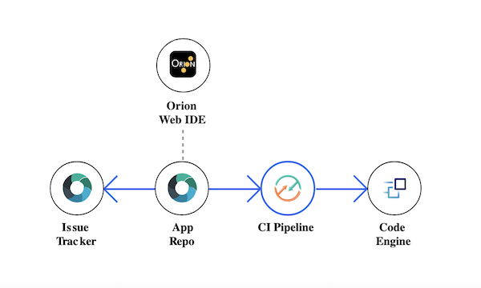

#  Developing a Code Engine app

## How Code Engine deployment works
IBM Cloud Code Engine provides a platform to unify the deployment of all of your container-based applications. Code Engine helps developers by hiding many of the complex tasks like configuration, dependency management etc. Code Engine simplifies container-based management and enables you to concentrate on writing code. It also makes available many of the features of a serverless platform, such as "scale-to-zero". The application code is stored in source control along with its Dockerfile. If you have not yet created a Code Engine project, the toolchain automatically generates one during deployment. Any code changes detected in the Git repo are automatically built, validated, and deployed into the Code Engine project. For more information, refer to the [Code Engine documentation](https://cloud.ibm.com/docs/codeengine).

## Creating a Code Engine app
You can continuously deliver a secure Code Engine app to a Code Engine project. Learn how to create a "Hello World" application that uses Docker, Node.js, and a DevOps toolchain. The app comes preconfigured for continuous delivery with the following features:
* Source control
* Issue tracking
* Online editing
* Deployment to IBM Code Engine

## Prerequisites
* Make sure the account that creates the toolchain pipeline based on the Code Engine template has proper permissions in the account. See "[Integrating Code Engine workloads with Continuous Delivery](https://cloud.ibm.com/docs/codeengine?topic=codeengine-toolchain-ce)" to learn more.
* Optional: Install the [IBM Cloud CLI and the IBM Cloud Code Engine plug-in](https://cloud.ibm.com/docs/codeengine?topic=codeengine-kn-install-cli) for managing Code Engine projects and applications on your local system.
* Optional: Create a [project](https://cloud.ibm.com/docs/codeengine?topic=codeengine-manage-project). If you do not create one, the toolchain will create one for you with the project name you enter.

1. To get started, click **Create toolchain**:
  
2. You can use the default settings, or make changes as needed.
3. Under **Tool Integrations**, select **Delivery Pipeline**.
4. Enter your **IBM Cloud API key**, or generate a new API key by clicking **Create**.
5. Confirm the container registry region, container registry namespace, Code Engine region, Code Engine resource group, and Code Engine project name.
6. Click **Create**.

The following best practices are implemented automatically upon app creation:
- Sanity check the Dockerfile before image creation.
- Build a container image on every Git commit, setting a tag based on build number, time stamp, and commit ID for traceability.
- Use a private image registry to store the image, and automatically configure access permissions for target cluster deployment by using API tokens that can be revoked.
- Insert the image tag into the deployment manifest automatically.

## Detailed description

- [Build](#build---tekton-pipelines)
- [Build (tasks)](#build---tekton-tasks)
- [Deployment](#deployment---tekton-pipelines)
- [Deployment (tasks)](#deployment---tekton-tasks)

### Build - Tekton Pipelines

This pipeline and relevant trigger(s) can be configured using the properties described below.

See https://cloud.ibm.com/docs/ContinuousDelivery?topic=ContinuousDelivery-tekton-pipelines&interface=ui#configure_tekton_pipeline for more information.

**EventListeners:**

- [manual-run](#manual-run)
- [github-commit](#github-commit)
- [grit-or-gitlab-commit](#grit-or-gitlab-commit)
- [bitbucket-commit](#bitbucket-commit)
- [github-pr-listener](#github-pr-listener)
- [gitlab-pr-listener](#gitlab-pr-listener)

#### manual-run

**EventListener**: manual-run

| Properties | Description | Default | Required | Type |
|------------|-------------|---------|----------|------|
| `apikey` | The ibmcloud api key | - | Yes | string |
| `apikey` (**secured property**) | [IBM Cloud Api Key](https://cloud.ibm.com/iam/apikeys) used to access to the toolchain (and git intergation toolcard like `Git Repos and Issue Tracking` service if used). | - | Yes | secret |
| `app-concurrency` | the maximum number of requests that can be processed concurrently per instance. | `100` | No | string |
| `app-deployment-timeout` | maximum timeout for the application deployment. | `300` | No | string |
| `app-health-endpoint` | application health endpoint, e.g. /health | `` | No | string |
| `app-max-scale` | maximum scale of the Code Engine application | `1` | No | string |
| `app-min-scale` | minimum scale of the Code Engine application | `0` | No | string |
| `app-name` | application name | - | Yes | string |
| `app-port` | port where the application is listening | `8080` | No | string |
| `app-visibility` | the visibility for the application. Valid values are 'public', 'private' and 'project'. | `public` | No | string |
| `asset-type` | Security checks to run (apps, image, os, all) | `all` | No | string |
| `bom-report` | Filepath to store generated Bill of Materials | `bom.json` | No | string |
| `branch` | the branch for the git repo | `main` | No | string |
| `build-size` | the size to use for the build, which determines the amount of resources used. Valid values include small, medium, large, xlarge. | `large` | No | string |
| `build-strategy` | The strategy to use for building the image. Valid values are 'dockerfile' and 'buildpacks'. | `dockerfile` | No | string |
| `build-timeout` | the amount of time, in seconds, that can pass before the build run must succeed or fail. | `1200` | No | string |
| `build-use-native-docker` | Optional property to opt-in for using native docker build capabilities as opposed to use Code Engine build to containerize the source. Note this setting only takes effect if the build-strategy is set to 'dockerfile'. Valid values are 'true' and 'false'. | `false` | No | string |
| `code-engine-project` | Code Engine project for the application deployment | - | Yes | string |
| `context` | context for the commit status check | `code-engine devops` | No | string |
| `cpu` | the amount of vCPU set for each instance of the application or job | `0.25` | No | string |
| `cra-custom-script` | Filepath to a custom script that is ran prior to CRA scanning | `` | No | string |
| `cra-scan-image` | Image to use for `code-risk-analyzer` task | `icr.io/continuous-delivery/pipeline/pipeline-base-ubi:3.46` | No | string |
| `custom-image-registry-dockerconfigjson` | dockerconfigjson for custom images used in pipeline tasks. See [Pipeline cannot pull images](https://cloud.ibm.com/docs/devsecops?topic=devsecops-troubleshoot-devsecops#troubleshoot-pipe-abort-early) | `eyJhdXRocyI6e319` | No | string |
| `custom-script` | The command(s) to run the build in run-build step. It will override the default commands | `` | No | string |
| `cveignore` | Filepath to cveignore | `` | No | string |
| `deploy-report` | Filepath to store generated Deploy Analytic report | `deploy.json` | No | string |
| `deployment-type` | Specifies the type of deployment. Valid values are 'application' and 'job'. | `application` | No | string |
| `description` | description for the commit status check | `code-engine devops (CI)` | No | string |
| `docker-build-context` | If specified, CRA will use the directory in the path parameter as docker build context | - | Yes | string |
| `docker-build-flags` | Customize docker build command for build stage scanning | `` | No | string |
| `docker-registry-secret` | Secret to authenticate for docker-registry-url | - | Yes | string |
| `docker-registry-secret` (**secured property**) | the secret used to login to docker-registry-url | - | Yes | secret |
| `docker-registry-url` | Registry url to use for docker login | `` | No | string |
| `docker-registry-username` | Username to authenticate for docker-registry-url | `` | No | string |
| `dockerfile` | The name of the Dockerfile to use for building the image | `Dockerfile` | No | string |
| `dockerfile-pattern` | Pattern to identify Dockerfile in the repository | - | Yes | string |
| `doi-environment` | the environment for DOI | `dev` | No | string |
| `env-from-configmaps` | semi-colon separated list of configmaps to set environment variables from | `` | No | string |
| `env-from-secrets` | semi-colon separated list of secrets to set environment variables from | `` | No | string |
| `env-props` | A custom configuration of environment properties to source before execution, ex. 'export ABC=123 export DEF=456' | `` | No | string |
| `ephemeral-storage` | the amount of ephemeral storage to set for each instance of the application or job | `0.4G` | No | string |
| `exclude-dev` | Exclude dev dependencies during vulnerability scan | `false` | No | string |
| `fail-on-cra-vulnerabilities` | force failure of task when code-risk-analyzer vulnerabilities are found (enables strict mode for scanning) | `false` | No | string |
| `fail-on-lint-errors` | force failure of task when docker lint errors are found | `true` | No | string |
| `fail-on-scanned-issues` | force failure of task when vulnerability advisor scan issues are found | `true` | No | string |
| `fail-on-test-errors` | flag (`true` or `false`) to indicate if the unit-test should be marked as fail or successfull | `true` | No | string |
| `fileignore` | Filepath to .fileignore | `` | No | string |
| `git-token` | access token for the git repo | `` | No | string |
| `gradle-exclude-configs` | Exclude gradle configurations, ex. 'runtimeClasspath,testCompileClasspath' | `` | No | string |
| `ibmcloud-api` | the ibmcloud api | `https://cloud.ibm.com` | No | string |
| `ibmcloud-region` | ibmcloud region to use | `` | No | string |
| `ibmcloud-trace` | Enables IBMCLOUD_TRACE for ibmcloud cli logging | `false` | No | string |
| `image-name` | image name | - | Yes | string |
| `job-instances` | Specifies the number of instances that are used for runs of the job. When you use this option, the system converts to array indices. For example, if you specify 'instances' of 5, the system converts to 'array-indices' of '0 - 4' | `1` | No | string |
| `job-maxexecutiontime` | The maximum execution time in seconds for runs of the job. | `7200` | No | string |
| `job-retrylimit` | The number of times to rerun an instance of the job before the job is marked as failed. | `3` | No | string |
| `maven-exclude-scopes` | Exclude maven scopes, ex. 'test,compile' | `` | No | string |
| `memory` | the amount of memory set for each instance of the application or job | `0.5G` | No | string |
| `nodejs-create-package-lock` | Enable the task to build the package-lock.json for node.js projects | `false` | No | string |
| `output` | Prints command result to console | `false` | No | string |
| `path` | Repository path to scan | `/artifacts` | No | string |
| `path-to-context` | the path to the context that is used for the build (`.` meaning current directory) | `.` | No | string |
| `path-to-dockerfile` | the path to the Dockerfile that is used for the build (`.` meaning current directory) | `.` | No | string |
| `pipeline-debug` | Pipeline debug mode. Value can be 0 or 1. Default to 0 | `0` | No | string |
| `prev-report` | Filepath to previous BoM report to skip Dockerfile or application manifest scans | `` | No | string |
| `region` | region of application deployment | - | Yes | string |
| `registry-create-namespace` | create container registry namespace if it doesn't already exists | `true` | No | string |
| `registry-namespace` | container registry namespace | - | Yes | string |
| `registry-region` | The IBM Cloud region for image registry | - | Yes | string |
| `remove-unspecified-references-to-configuration-resources` | remove references to unspecified configuration resources (configmap/secret) references (pulled from env-from-configmaps, env-from-secrets along with auto-managed by CD) | `false` | No | string |
| `repository` | the git repo containing source code. If empty, the repository url will be found from toolchain | `` | No | string |
| `resource-group` | resource group for the application deployment | - | Yes | string |
| `revision` | the git revision/commit for the git repo | `` | No | string |
| `service-bindings` | JSON object of a map of names to services instances to be bound to the application | `{}` | No | string |
| `suffix-for-cd-auto-managed-configuration-resources` | suffix for secret or configmap created based on CD environment properties | `` | No | string |
| `tester-tests-image` | Image to use for `unit-test` task | `icr.io/continuous-delivery/pipeline/pipeline-base-ubi:3.46` | No | string |
| `toolchain-build-image` | Image to use for `build` task | `icr.io/continuous-delivery/pipeline/pipeline-base-ubi:3.46` | No | string |
| `toolchainid` | The target toolchain id to be used. Defaults to the current toolchain id | `` | No | string |
| `verbose` | Enable verbose log messages | `false` | No | string |
| `vulnerability-report` | Filepath to store Vulnerability report, not stored if empty | `vulnerability.json` | No | string |
| `wait-timeout` | Maximum timeout for the CLI operation to wait. | `1300` | No | string |

#### github-commit

**EventListener**: github-commit

| Properties | Description | Default | Required | Type |
|------------|-------------|---------|----------|------|
| `apikey` | The ibmcloud api key | - | Yes | string |
| `apikey` (**secured property**) | [IBM Cloud Api Key](https://cloud.ibm.com/iam/apikeys) used to access to the toolchain (and git intergation toolcard like `Git Repos and Issue Tracking` service if used). | - | Yes | secret |
| `app-concurrency` | the maximum number of requests that can be processed concurrently per instance. | `100` | No | string |
| `app-deployment-timeout` | maximum timeout for the application deployment. | `300` | No | string |
| `app-health-endpoint` | application health endpoint, e.g. /health | `` | No | string |
| `app-max-scale` | maximum scale of the Code Engine application | `1` | No | string |
| `app-min-scale` | minimum scale of the Code Engine application | `0` | No | string |
| `app-name` | application name | - | Yes | string |
| `app-port` | port where the application is listening | `8080` | No | string |
| `app-visibility` | the visibility for the application. Valid values are 'public', 'private' and 'project'. | `public` | No | string |
| `asset-type` | Security checks to run (apps, image, os, all) | `all` | No | string |
| `bom-report` | Filepath to store generated Bill of Materials | `bom.json` | No | string |
| `branch` | the branch for the git repo | `$(event.ref)` | No | string |
| `build-size` | the size to use for the build, which determines the amount of resources used. Valid values include small, medium, large, xlarge. | `large` | No | string |
| `build-strategy` | The strategy to use for building the image. Valid values are 'dockerfile' and 'buildpacks'. | `dockerfile` | No | string |
| `build-timeout` | the amount of time, in seconds, that can pass before the build run must succeed or fail. | `1200` | No | string |
| `build-use-native-docker` | Optional property to opt-in for using native docker build capabilities as opposed to use Code Engine build to containerize the source. Note this setting only takes effect if the build-strategy is set to 'dockerfile'. Valid values are 'true' and 'false'. | `false` | No | string |
| `code-engine-project` | Code Engine project for the application deployment | - | Yes | string |
| `context` | context for the commit status check | `code-engine devops` | No | string |
| `cpu` | the amount of vCPU set for each instance of the application or job | `0.25` | No | string |
| `cra-custom-script` | Filepath to a custom script that is ran prior to CRA scanning | `` | No | string |
| `cra-scan-image` | Image to use for `code-risk-analyzer` task | `icr.io/continuous-delivery/pipeline/pipeline-base-ubi:3.46` | No | string |
| `custom-image-registry-dockerconfigjson` | dockerconfigjson for custom images used in pipeline tasks. See [Pipeline cannot pull images](https://cloud.ibm.com/docs/devsecops?topic=devsecops-troubleshoot-devsecops#troubleshoot-pipe-abort-early) | `eyJhdXRocyI6e319` | No | string |
| `custom-script` | The command(s) to run the build in run-build step. It will override the default commands | `` | No | string |
| `cveignore` | Filepath to cveignore | `` | No | string |
| `deploy-report` | Filepath to store generated Deploy Analytic report | `deploy.json` | No | string |
| `deployment-type` | Specifies the type of deployment. Valid values are 'application' and 'job'. | `application` | No | string |
| `description` | description for the commit status check | `code-engine devops (CI)` | No | string |
| `docker-build-context` | If specified, CRA will use the directory in the path parameter as docker build context | - | Yes | string |
| `docker-build-flags` | Customize docker build command for build stage scanning | `` | No | string |
| `docker-registry-secret` | Secret to authenticate for docker-registry-url | - | Yes | string |
| `docker-registry-secret` (**secured property**) | the secret used to login to docker-registry-url | - | Yes | secret |
| `docker-registry-url` | Registry url to use for docker login | `` | No | string |
| `docker-registry-username` | Username to authenticate for docker-registry-url | `` | No | string |
| `dockerfile` | The name of the Dockerfile to use for building the image | `Dockerfile` | No | string |
| `dockerfile-pattern` | Pattern to identify Dockerfile in the repository | - | Yes | string |
| `doi-environment` | the environment for DOI | `dev` | No | string |
| `env-from-configmaps` | semi-colon separated list of configmaps to set environment variables from | `` | No | string |
| `env-from-secrets` | semi-colon separated list of secrets to set environment variables from | `` | No | string |
| `env-props` | A custom configuration of environment properties to source before execution, ex. 'export ABC=123 export DEF=456' | `` | No | string |
| `ephemeral-storage` | the amount of ephemeral storage to set for each instance of the application or job | `0.4G` | No | string |
| `exclude-dev` | Exclude dev dependencies during vulnerability scan | `false` | No | string |
| `fail-on-cra-vulnerabilities` | force failure of task when code-risk-analyzer vulnerabilities are found (enables strict mode for scanning) | `false` | No | string |
| `fail-on-lint-errors` | force failure of task when docker lint errors are found | `true` | No | string |
| `fail-on-scanned-issues` | force failure of task when vulnerability advisor scan issues are found | `true` | No | string |
| `fail-on-test-errors` | flag (`true` or `false`) to indicate if the unit-test should be marked as fail or successfull | `true` | No | string |
| `fileignore` | Filepath to .fileignore | `` | No | string |
| `git-token` | access token for the git repo | `` | No | string |
| `gradle-exclude-configs` | Exclude gradle configurations, ex. 'runtimeClasspath,testCompileClasspath' | `` | No | string |
| `ibmcloud-api` | the ibmcloud api | `https://cloud.ibm.com` | No | string |
| `ibmcloud-region` | ibmcloud region to use | `` | No | string |
| `ibmcloud-trace` | Enables IBMCLOUD_TRACE for ibmcloud cli logging | `false` | No | string |
| `image-name` | image name | - | Yes | string |
| `job-instances` | Specifies the number of instances that are used for runs of the job. When you use this option, the system converts to array indices. For example, if you specify 'instances' of 5, the system converts to 'array-indices' of '0 - 4' | `1` | No | string |
| `job-maxexecutiontime` | The maximum execution time in seconds for runs of the job. | `7200` | No | string |
| `job-retrylimit` | The number of times to rerun an instance of the job before the job is marked as failed. | `3` | No | string |
| `maven-exclude-scopes` | Exclude maven scopes, ex. 'test,compile' | `` | No | string |
| `memory` | the amount of memory set for each instance of the application or job | `0.5G` | No | string |
| `nodejs-create-package-lock` | Enable the task to build the package-lock.json for node.js projects | `false` | No | string |
| `output` | Prints command result to console | `false` | No | string |
| `path` | Repository path to scan | `/artifacts` | No | string |
| `path-to-context` | the path to the context that is used for the build (`.` meaning current directory) | `.` | No | string |
| `path-to-dockerfile` | the path to the Dockerfile that is used for the build (`.` meaning current directory) | `.` | No | string |
| `pipeline-debug` | Pipeline debug mode. Value can be 0 or 1. Default to 0 | `0` | No | string |
| `prev-report` | Filepath to previous BoM report to skip Dockerfile or application manifest scans | `` | No | string |
| `region` | region of application deployment | - | Yes | string |
| `registry-create-namespace` | create container registry namespace if it doesn't already exists | `true` | No | string |
| `registry-namespace` | container registry namespace | - | Yes | string |
| `registry-region` | The IBM Cloud region for image registry | - | Yes | string |
| `remove-unspecified-references-to-configuration-resources` | remove references to unspecified configuration resources (configmap/secret) references (pulled from env-from-configmaps, env-from-secrets along with auto-managed by CD) | `false` | No | string |
| `repository` | the git repo containing source code. If empty, the repository url will be found from toolchain | `$(event.repository.html_url)` | No | string |
| `resource-group` | resource group for the application deployment | - | Yes | string |
| `revision` | the git revision/commit for the git repo | `$(event.head_commit.id)` | No | string |
| `service-bindings` | JSON object of a map of names to services instances to be bound to the application | `{}` | No | string |
| `suffix-for-cd-auto-managed-configuration-resources` | suffix for secret or configmap created based on CD environment properties | `` | No | string |
| `tester-tests-image` | Image to use for `unit-test` task | `icr.io/continuous-delivery/pipeline/pipeline-base-ubi:3.46` | No | string |
| `toolchain-build-image` | Image to use for `build` task | `icr.io/continuous-delivery/pipeline/pipeline-base-ubi:3.46` | No | string |
| `toolchainid` | The target toolchain id to be used. Defaults to the current toolchain id | `` | No | string |
| `verbose` | Enable verbose log messages | `false` | No | string |
| `vulnerability-report` | Filepath to store Vulnerability report, not stored if empty | `vulnerability.json` | No | string |
| `wait-timeout` | Maximum timeout for the CLI operation to wait. | `1300` | No | string |

#### grit-or-gitlab-commit

**EventListener**: grit-or-gitlab-commit

| Properties | Description | Default | Required | Type |
|------------|-------------|---------|----------|------|
| `apikey` | The ibmcloud api key | - | Yes | string |
| `apikey` (**secured property**) | [IBM Cloud Api Key](https://cloud.ibm.com/iam/apikeys) used to access to the toolchain (and git intergation toolcard like `Git Repos and Issue Tracking` service if used). | - | Yes | secret |
| `app-concurrency` | the maximum number of requests that can be processed concurrently per instance. | `100` | No | string |
| `app-deployment-timeout` | maximum timeout for the application deployment. | `300` | No | string |
| `app-health-endpoint` | application health endpoint, e.g. /health | `` | No | string |
| `app-max-scale` | maximum scale of the Code Engine application | `1` | No | string |
| `app-min-scale` | minimum scale of the Code Engine application | `0` | No | string |
| `app-name` | application name | - | Yes | string |
| `app-port` | port where the application is listening | `8080` | No | string |
| `app-visibility` | the visibility for the application. Valid values are 'public', 'private' and 'project'. | `public` | No | string |
| `asset-type` | Security checks to run (apps, image, os, all) | `all` | No | string |
| `bom-report` | Filepath to store generated Bill of Materials | `bom.json` | No | string |
| `branch` | the branch for the git repo | `$(event.ref)` | No | string |
| `build-size` | the size to use for the build, which determines the amount of resources used. Valid values include small, medium, large, xlarge. | `large` | No | string |
| `build-strategy` | The strategy to use for building the image. Valid values are 'dockerfile' and 'buildpacks'. | `dockerfile` | No | string |
| `build-timeout` | the amount of time, in seconds, that can pass before the build run must succeed or fail. | `1200` | No | string |
| `build-use-native-docker` | Optional property to opt-in for using native docker build capabilities as opposed to use Code Engine build to containerize the source. Note this setting only takes effect if the build-strategy is set to 'dockerfile'. Valid values are 'true' and 'false'. | `false` | No | string |
| `code-engine-project` | Code Engine project for the application deployment | - | Yes | string |
| `context` | context for the commit status check | `code-engine devops` | No | string |
| `cpu` | the amount of vCPU set for each instance of the application or job | `0.25` | No | string |
| `cra-custom-script` | Filepath to a custom script that is ran prior to CRA scanning | `` | No | string |
| `cra-scan-image` | Image to use for `code-risk-analyzer` task | `icr.io/continuous-delivery/pipeline/pipeline-base-ubi:3.46` | No | string |
| `custom-image-registry-dockerconfigjson` | dockerconfigjson for custom images used in pipeline tasks. See [Pipeline cannot pull images](https://cloud.ibm.com/docs/devsecops?topic=devsecops-troubleshoot-devsecops#troubleshoot-pipe-abort-early) | `eyJhdXRocyI6e319` | No | string |
| `custom-script` | The command(s) to run the build in run-build step. It will override the default commands | `` | No | string |
| `cveignore` | Filepath to cveignore | `` | No | string |
| `deploy-report` | Filepath to store generated Deploy Analytic report | `deploy.json` | No | string |
| `deployment-type` | Specifies the type of deployment. Valid values are 'application' and 'job'. | `application` | No | string |
| `description` | description for the commit status check | `code-engine devops (CI)` | No | string |
| `docker-build-context` | If specified, CRA will use the directory in the path parameter as docker build context | - | Yes | string |
| `docker-build-flags` | Customize docker build command for build stage scanning | `` | No | string |
| `docker-registry-secret` | Secret to authenticate for docker-registry-url | - | Yes | string |
| `docker-registry-secret` (**secured property**) | the secret used to login to docker-registry-url | - | Yes | secret |
| `docker-registry-url` | Registry url to use for docker login | `` | No | string |
| `docker-registry-username` | Username to authenticate for docker-registry-url | `` | No | string |
| `dockerfile` | The name of the Dockerfile to use for building the image | `Dockerfile` | No | string |
| `dockerfile-pattern` | Pattern to identify Dockerfile in the repository | - | Yes | string |
| `doi-environment` | the environment for DOI | `dev` | No | string |
| `env-from-configmaps` | semi-colon separated list of configmaps to set environment variables from | `` | No | string |
| `env-from-secrets` | semi-colon separated list of secrets to set environment variables from | `` | No | string |
| `env-props` | A custom configuration of environment properties to source before execution, ex. 'export ABC=123 export DEF=456' | `` | No | string |
| `ephemeral-storage` | the amount of ephemeral storage to set for each instance of the application or job | `0.4G` | No | string |
| `exclude-dev` | Exclude dev dependencies during vulnerability scan | `false` | No | string |
| `fail-on-cra-vulnerabilities` | force failure of task when code-risk-analyzer vulnerabilities are found (enables strict mode for scanning) | `false` | No | string |
| `fail-on-lint-errors` | force failure of task when docker lint errors are found | `true` | No | string |
| `fail-on-scanned-issues` | force failure of task when vulnerability advisor scan issues are found | `true` | No | string |
| `fail-on-test-errors` | flag (`true` or `false`) to indicate if the unit-test should be marked as fail or successfull | `true` | No | string |
| `fileignore` | Filepath to .fileignore | `` | No | string |
| `git-token` | access token for the git repo | `` | No | string |
| `gradle-exclude-configs` | Exclude gradle configurations, ex. 'runtimeClasspath,testCompileClasspath' | `` | No | string |
| `ibmcloud-api` | the ibmcloud api | `https://cloud.ibm.com` | No | string |
| `ibmcloud-region` | ibmcloud region to use | `` | No | string |
| `ibmcloud-trace` | Enables IBMCLOUD_TRACE for ibmcloud cli logging | `false` | No | string |
| `image-name` | image name | - | Yes | string |
| `job-instances` | Specifies the number of instances that are used for runs of the job. When you use this option, the system converts to array indices. For example, if you specify 'instances' of 5, the system converts to 'array-indices' of '0 - 4' | `1` | No | string |
| `job-maxexecutiontime` | The maximum execution time in seconds for runs of the job. | `7200` | No | string |
| `job-retrylimit` | The number of times to rerun an instance of the job before the job is marked as failed. | `3` | No | string |
| `maven-exclude-scopes` | Exclude maven scopes, ex. 'test,compile' | `` | No | string |
| `memory` | the amount of memory set for each instance of the application or job | `0.5G` | No | string |
| `nodejs-create-package-lock` | Enable the task to build the package-lock.json for node.js projects | `false` | No | string |
| `output` | Prints command result to console | `false` | No | string |
| `path` | Repository path to scan | `/artifacts` | No | string |
| `path-to-context` | the path to the context that is used for the build (`.` meaning current directory) | `.` | No | string |
| `path-to-dockerfile` | the path to the Dockerfile that is used for the build (`.` meaning current directory) | `.` | No | string |
| `pipeline-debug` | Pipeline debug mode. Value can be 0 or 1. Default to 0 | `0` | No | string |
| `prev-report` | Filepath to previous BoM report to skip Dockerfile or application manifest scans | `` | No | string |
| `region` | region of application deployment | - | Yes | string |
| `registry-create-namespace` | create container registry namespace if it doesn't already exists | `true` | No | string |
| `registry-namespace` | container registry namespace | - | Yes | string |
| `registry-region` | The IBM Cloud region for image registry | - | Yes | string |
| `remove-unspecified-references-to-configuration-resources` | remove references to unspecified configuration resources (configmap/secret) references (pulled from env-from-configmaps, env-from-secrets along with auto-managed by CD) | `false` | No | string |
| `repository` | the git repo containing source code. If empty, the repository url will be found from toolchain | `$(event.repository.git_http_url)` | No | string |
| `resource-group` | resource group for the application deployment | - | Yes | string |
| `revision` | the git revision/commit for the git repo | `$(event.checkout_sha)` | No | string |
| `service-bindings` | JSON object of a map of names to services instances to be bound to the application | `{}` | No | string |
| `suffix-for-cd-auto-managed-configuration-resources` | suffix for secret or configmap created based on CD environment properties | `` | No | string |
| `tester-tests-image` | Image to use for `unit-test` task | `icr.io/continuous-delivery/pipeline/pipeline-base-ubi:3.46` | No | string |
| `toolchain-build-image` | Image to use for `build` task | `icr.io/continuous-delivery/pipeline/pipeline-base-ubi:3.46` | No | string |
| `toolchainid` | The target toolchain id to be used. Defaults to the current toolchain id | `` | No | string |
| `verbose` | Enable verbose log messages | `false` | No | string |
| `vulnerability-report` | Filepath to store Vulnerability report, not stored if empty | `vulnerability.json` | No | string |
| `wait-timeout` | Maximum timeout for the CLI operation to wait. | `1300` | No | string |

#### bitbucket-commit

**EventListener**: bitbucket-commit

| Properties | Description | Default | Required | Type |
|------------|-------------|---------|----------|------|
| `apikey` | The ibmcloud api key | - | Yes | string |
| `apikey` (**secured property**) | [IBM Cloud Api Key](https://cloud.ibm.com/iam/apikeys) used to access to the toolchain (and git intergation toolcard like `Git Repos and Issue Tracking` service if used). | - | Yes | secret |
| `app-concurrency` | the maximum number of requests that can be processed concurrently per instance. | `100` | No | string |
| `app-deployment-timeout` | maximum timeout for the application deployment. | `300` | No | string |
| `app-health-endpoint` | application health endpoint, e.g. /health | `` | No | string |
| `app-max-scale` | maximum scale of the Code Engine application | `1` | No | string |
| `app-min-scale` | minimum scale of the Code Engine application | `0` | No | string |
| `app-name` | application name | - | Yes | string |
| `app-port` | port where the application is listening | `8080` | No | string |
| `app-visibility` | the visibility for the application. Valid values are 'public', 'private' and 'project'. | `public` | No | string |
| `asset-type` | Security checks to run (apps, image, os, all) | `all` | No | string |
| `bom-report` | Filepath to store generated Bill of Materials | `bom.json` | No | string |
| `branch` | the branch for the git repo | `$(event.push.changes[0].new.name)` | No | string |
| `build-size` | the size to use for the build, which determines the amount of resources used. Valid values include small, medium, large, xlarge. | `large` | No | string |
| `build-strategy` | The strategy to use for building the image. Valid values are 'dockerfile' and 'buildpacks'. | `dockerfile` | No | string |
| `build-timeout` | the amount of time, in seconds, that can pass before the build run must succeed or fail. | `1200` | No | string |
| `build-use-native-docker` | Optional property to opt-in for using native docker build capabilities as opposed to use Code Engine build to containerize the source. Note this setting only takes effect if the build-strategy is set to 'dockerfile'. Valid values are 'true' and 'false'. | `false` | No | string |
| `code-engine-project` | Code Engine project for the application deployment | - | Yes | string |
| `context` | context for the commit status check | `code-engine devops` | No | string |
| `cpu` | the amount of vCPU set for each instance of the application or job | `0.25` | No | string |
| `cra-custom-script` | Filepath to a custom script that is ran prior to CRA scanning | `` | No | string |
| `cra-scan-image` | Image to use for `code-risk-analyzer` task | `icr.io/continuous-delivery/pipeline/pipeline-base-ubi:3.46` | No | string |
| `custom-image-registry-dockerconfigjson` | dockerconfigjson for custom images used in pipeline tasks. See [Pipeline cannot pull images](https://cloud.ibm.com/docs/devsecops?topic=devsecops-troubleshoot-devsecops#troubleshoot-pipe-abort-early) | `eyJhdXRocyI6e319` | No | string |
| `custom-script` | The command(s) to run the build in run-build step. It will override the default commands | `` | No | string |
| `cveignore` | Filepath to cveignore | `` | No | string |
| `deploy-report` | Filepath to store generated Deploy Analytic report | `deploy.json` | No | string |
| `deployment-type` | Specifies the type of deployment. Valid values are 'application' and 'job'. | `application` | No | string |
| `description` | description for the commit status check | `code-engine devops (CI)` | No | string |
| `docker-build-context` | If specified, CRA will use the directory in the path parameter as docker build context | - | Yes | string |
| `docker-build-flags` | Customize docker build command for build stage scanning | `` | No | string |
| `docker-registry-secret` | Secret to authenticate for docker-registry-url | - | Yes | string |
| `docker-registry-secret` (**secured property**) | the secret used to login to docker-registry-url | - | Yes | secret |
| `docker-registry-url` | Registry url to use for docker login | `` | No | string |
| `docker-registry-username` | Username to authenticate for docker-registry-url | `` | No | string |
| `dockerfile` | The name of the Dockerfile to use for building the image | `Dockerfile` | No | string |
| `dockerfile-pattern` | Pattern to identify Dockerfile in the repository | - | Yes | string |
| `doi-environment` | the environment for DOI | `dev` | No | string |
| `env-from-configmaps` | semi-colon separated list of configmaps to set environment variables from | `` | No | string |
| `env-from-secrets` | semi-colon separated list of secrets to set environment variables from | `` | No | string |
| `env-props` | A custom configuration of environment properties to source before execution, ex. 'export ABC=123 export DEF=456' | `` | No | string |
| `ephemeral-storage` | the amount of ephemeral storage to set for each instance of the application or job | `0.4G` | No | string |
| `exclude-dev` | Exclude dev dependencies during vulnerability scan | `false` | No | string |
| `fail-on-cra-vulnerabilities` | force failure of task when code-risk-analyzer vulnerabilities are found (enables strict mode for scanning) | `false` | No | string |
| `fail-on-lint-errors` | force failure of task when docker lint errors are found | `true` | No | string |
| `fail-on-scanned-issues` | force failure of task when vulnerability advisor scan issues are found | `true` | No | string |
| `fail-on-test-errors` | flag (`true` or `false`) to indicate if the unit-test should be marked as fail or successfull | `true` | No | string |
| `fileignore` | Filepath to .fileignore | `` | No | string |
| `git-token` | access token for the git repo | `` | No | string |
| `gradle-exclude-configs` | Exclude gradle configurations, ex. 'runtimeClasspath,testCompileClasspath' | `` | No | string |
| `ibmcloud-api` | the ibmcloud api | `https://cloud.ibm.com` | No | string |
| `ibmcloud-region` | ibmcloud region to use | `` | No | string |
| `ibmcloud-trace` | Enables IBMCLOUD_TRACE for ibmcloud cli logging | `false` | No | string |
| `image-name` | image name | - | Yes | string |
| `job-instances` | Specifies the number of instances that are used for runs of the job. When you use this option, the system converts to array indices. For example, if you specify 'instances' of 5, the system converts to 'array-indices' of '0 - 4' | `1` | No | string |
| `job-maxexecutiontime` | The maximum execution time in seconds for runs of the job. | `7200` | No | string |
| `job-retrylimit` | The number of times to rerun an instance of the job before the job is marked as failed. | `3` | No | string |
| `maven-exclude-scopes` | Exclude maven scopes, ex. 'test,compile' | `` | No | string |
| `memory` | the amount of memory set for each instance of the application or job | `0.5G` | No | string |
| `nodejs-create-package-lock` | Enable the task to build the package-lock.json for node.js projects | `false` | No | string |
| `output` | Prints command result to console | `false` | No | string |
| `path` | Repository path to scan | `/artifacts` | No | string |
| `path-to-context` | the path to the context that is used for the build (`.` meaning current directory) | `.` | No | string |
| `path-to-dockerfile` | the path to the Dockerfile that is used for the build (`.` meaning current directory) | `.` | No | string |
| `pipeline-debug` | Pipeline debug mode. Value can be 0 or 1. Default to 0 | `0` | No | string |
| `prev-report` | Filepath to previous BoM report to skip Dockerfile or application manifest scans | `` | No | string |
| `region` | region of application deployment | - | Yes | string |
| `registry-create-namespace` | create container registry namespace if it doesn't already exists | `true` | No | string |
| `registry-namespace` | container registry namespace | - | Yes | string |
| `registry-region` | The IBM Cloud region for image registry | - | Yes | string |
| `remove-unspecified-references-to-configuration-resources` | remove references to unspecified configuration resources (configmap/secret) references (pulled from env-from-configmaps, env-from-secrets along with auto-managed by CD) | `false` | No | string |
| `repository` | the git repo containing source code. If empty, the repository url will be found from toolchain | `$(event.repository.links.html.href)` | No | string |
| `resource-group` | resource group for the application deployment | - | Yes | string |
| `revision` | the git revision/commit for the git repo | `$(event.push.changes[0].new.target.hash)` | No | string |
| `service-bindings` | JSON object of a map of names to services instances to be bound to the application | `{}` | No | string |
| `suffix-for-cd-auto-managed-configuration-resources` | suffix for secret or configmap created based on CD environment properties | `` | No | string |
| `tester-tests-image` | Image to use for `unit-test` task | `icr.io/continuous-delivery/pipeline/pipeline-base-ubi:3.46` | No | string |
| `toolchain-build-image` | Image to use for `build` task | `icr.io/continuous-delivery/pipeline/pipeline-base-ubi:3.46` | No | string |
| `toolchainid` | The target toolchain id to be used. Defaults to the current toolchain id | `` | No | string |
| `verbose` | Enable verbose log messages | `false` | No | string |
| `vulnerability-report` | Filepath to store Vulnerability report, not stored if empty | `vulnerability.json` | No | string |
| `wait-timeout` | Maximum timeout for the CLI operation to wait. | `1300` | No | string |

#### github-pr-listener

**EventListener**: github-pr-listener

| Properties | Description | Default | Required | Type |
|------------|-------------|---------|----------|------|
| `apikey` | The ibmcloud api key | - | Yes | string |
| `apikey` (**secured property**) | the api key used to login to ibmcloud | - | Yes | secret |
| `asset-type` | Security checks to run (apps, image, os, all) | `all` | No | string |
| `bom-report` | Filepath to store generated Bill of Materials. Default to `./bom.json` | `bom.json` | No | string |
| `build-script` | The command(s) to run the build in run-build step. It will override the default commands | `` | No | string |
| `context` | context for the commit status check | `code-engine devops` | No | string |
| `cra-custom-script` | A custom script to be ran prior to CRA scanning | `` | No | string |
| `cra-scan-image` | Image to use for `scan` task. Default to `icr.io/continuous-delivery/pipeline/pipeline-base-ubi:3.46` | `icr.io/continuous-delivery/pipeline/pipeline-base-ubi:3.46` | No | string |
| `custom-image-registry-dockerconfigjson` | dockerconfigjson for custom images used in pipeline tasks. See [Pipeline cannot pull images](https://cloud.ibm.com/docs/devsecops?topic=devsecops-troubleshoot-devsecops#troubleshoot-pipe-abort-early) | `eyJhdXRocyI6e319` | No | string |
| `cveignore` | Filepath to cveignore | `` | No | string |
| `deploy-report` | Filepath to store generated Deploy Analytic report. Default to `./deploy.json` | `deploy.json` | No | string |
| `description` | description for the commit status check | `code-engine devops (PR)` | No | string |
| `docker-build-flags` | Customize docker build command for build stage scanning | `` | No | string |
| `docker-registry-secret` | Secret to authenticate for docker-registry-url | - | Yes | string |
| `docker-registry-secret` (**secured property**) | the secret used to login to docker-registry-url | - | Yes | secret |
| `docker-registry-url` | Registry url to use for docker login | `` | No | string |
| `docker-registry-username` | Username to authenticate for docker-registry-url | `` | No | string |
| `env-props` | A custom configuration of environment properties to source before execution, ex. 'export ABC=123 export DEF=456' | `` | No | string |
| `exclude-dev` | Exclude dev dependencies during vulnerability scan | `false` | No | string |
| `fail-on-cra-vulnerabilities` | force failure of task when code-risk-analyzer vulnerabilities are found (enables strict mode for scanning) | `false` | No | string |
| `fail-on-test-errors` | flag (`true` or `false`) to indicate if the unit-test should be marked as fail or successfull | `true` | No | string |
| `fileignore` | Filepath to .fileignore | `` | No | string |
| `git-token` | access token for the git repo | `` | No | string |
| `gradle-exclude-configs` | Exclude gradle configurations, ex. 'runtimeClasspath,testCompileClasspath' | `` | No | string |
| `ibmcloud-api` | the ibmcloud api | `https://cloud.ibm.com` | No | string |
| `ibmcloud-region` | ibmcloud region to use | `` | No | string |
| `ibmcloud-trace` | Enables IBMCLOUD_TRACE for ibmcloud cli logging | `false` | No | string |
| `maven-exclude-scopes` | Exclude maven scopes, ex. 'test,compile' | `` | No | string |
| `nodejs-create-package-lock` | Enable the task to build the package-lock.json for node.js projects | `false` | No | string |
| `output` | Prints command result to console | `false` | No | string |
| `path` | Repository path to scan | `/artifacts` | No | string |
| `pipeline-debug` | Toggles debug mode for the pipeline | `0` | No | string |
| `pr-branch` | The branch in the forked git repo from where the PR is made | `$(event.pull_request.head.ref)` | No | string |
| `pr-commit-id` | the commit id/sha for the PullRequest | `$(event.pull_request.head.sha)` | No | string |
| `pr-commit-timestamp` | - | `$(event.pull_request.head.repo.pushed_at)` | No | string |
| `pr-name` | - | `$(event.pull_request.user.login)` | No | string |
| `pr-number` | - | `$(event.pull_request.number)` | No | string |
| `pr-repository` | The forked git repo from where the PR is made | `$(event.pull_request.head.repo.clone_url)` | No | string |
| `prev-report` | Filepath to previous BoM report to skip Dockerfile or application manifest scans | `` | No | string |
| `registry-region` | The ibmcloud container registry region | `` | No | string |
| `resource-group` | Target resource group (name or id) for the ibmcloud login operation | `` | No | string |
| `scm-type` | - | `github` | No | string |
| `target-branch` | the branch for the git repo | `$(event.pull_request.base.ref)` | No | string |
| `target-commit-id` | - | `$(event.pull_request.base.sha)` | No | string |
| `target-repository` | the git repo | `$(event.pull_request.base.repo.clone_url)` | No | string |
| `tester-tests-image` | Image to use for `unit-test` task | `icr.io/continuous-delivery/pipeline/pipeline-base-ubi:3.46` | No | string |
| `toolchain-build-image` | Image to use for `build` task | `icr.io/continuous-delivery/pipeline/pipeline-base-ubi:3.46` | No | string |
| `toolchainid` | The target toolchain id to be used. Defaults to the current toolchain id | `` | No | string |
| `verbose` | Enable verbose log messages | `false` | No | string |
| `vulnerability-report` | Filepath to store Vulnerability report, not stored if empty. Default to `./vulnerability.json` | `vulnerability.json` | No | string |

#### gitlab-pr-listener

**EventListener**: gitlab-pr-listener

| Properties | Description | Default | Required | Type |
|------------|-------------|---------|----------|------|
| `apikey` | The ibmcloud api key | - | Yes | string |
| `apikey` (**secured property**) | the api key used to login to ibmcloud | - | Yes | secret |
| `asset-type` | Security checks to run (apps, image, os, all) | `all` | No | string |
| `bom-report` | Filepath to store generated Bill of Materials. Default to `./bom.json` | `bom.json` | No | string |
| `build-script` | The command(s) to run the build in run-build step. It will override the default commands | `` | No | string |
| `context` | context for the commit status check | `code-engine devops` | No | string |
| `cra-custom-script` | A custom script to be ran prior to CRA scanning | `` | No | string |
| `cra-scan-image` | Image to use for `scan` task. Default to `icr.io/continuous-delivery/pipeline/pipeline-base-ubi:3.46` | `icr.io/continuous-delivery/pipeline/pipeline-base-ubi:3.46` | No | string |
| `custom-image-registry-dockerconfigjson` | dockerconfigjson for custom images used in pipeline tasks. See [Pipeline cannot pull images](https://cloud.ibm.com/docs/devsecops?topic=devsecops-troubleshoot-devsecops#troubleshoot-pipe-abort-early) | `eyJhdXRocyI6e319` | No | string |
| `cveignore` | Filepath to cveignore | `` | No | string |
| `deploy-report` | Filepath to store generated Deploy Analytic report. Default to `./deploy.json` | `deploy.json` | No | string |
| `description` | description for the commit status check | `code-engine devops (PR)` | No | string |
| `docker-build-flags` | Customize docker build command for build stage scanning | `` | No | string |
| `docker-registry-secret` | Secret to authenticate for docker-registry-url | - | Yes | string |
| `docker-registry-secret` (**secured property**) | the secret used to login to docker-registry-url | - | Yes | secret |
| `docker-registry-url` | Registry url to use for docker login | `` | No | string |
| `docker-registry-username` | Username to authenticate for docker-registry-url | `` | No | string |
| `env-props` | A custom configuration of environment properties to source before execution, ex. 'export ABC=123 export DEF=456' | `` | No | string |
| `exclude-dev` | Exclude dev dependencies during vulnerability scan | `false` | No | string |
| `fail-on-cra-vulnerabilities` | force failure of task when code-risk-analyzer vulnerabilities are found (enables strict mode for scanning) | `false` | No | string |
| `fail-on-test-errors` | flag (`true` or `false`) to indicate if the unit-test should be marked as fail or successfull | `true` | No | string |
| `fileignore` | Filepath to .fileignore | `` | No | string |
| `git-token` | access token for the git repo | `` | No | string |
| `gradle-exclude-configs` | Exclude gradle configurations, ex. 'runtimeClasspath,testCompileClasspath' | `` | No | string |
| `ibmcloud-api` | the ibmcloud api | `https://cloud.ibm.com` | No | string |
| `ibmcloud-region` | ibmcloud region to use | `` | No | string |
| `ibmcloud-trace` | Enables IBMCLOUD_TRACE for ibmcloud cli logging | `false` | No | string |
| `maven-exclude-scopes` | Exclude maven scopes, ex. 'test,compile' | `` | No | string |
| `nodejs-create-package-lock` | Enable the task to build the package-lock.json for node.js projects | `false` | No | string |
| `output` | Prints command result to console | `false` | No | string |
| `path` | Repository path to scan | `/artifacts` | No | string |
| `pipeline-debug` | Toggles debug mode for the pipeline | `0` | No | string |
| `pr-branch` | The branch in the forked git repo from where the PR is made | `$(event.object_attributes.source_branch)` | No | string |
| `pr-commit-id` | the commit id/sha for the PullRequest | `$(event.object_attributes.last_commit.id)` | No | string |
| `pr-commit-timestamp` | - | `$(event.object_attributes.last_commit.timestamp)` | No | string |
| `pr-name` | - | `$(event.user.username)` | No | string |
| `pr-number` | - | `$(event.object_attributes.iid)` | No | string |
| `pr-repository` | The forked git repo from where the PR is made | `$(event.object_attributes.source.git_http_url)` | No | string |
| `prev-report` | Filepath to previous BoM report to skip Dockerfile or application manifest scans | `` | No | string |
| `project-id` | - | `$(event.project.id)` | No | string |
| `registry-region` | The ibmcloud container registry region | `` | No | string |
| `resource-group` | Target resource group (name or id) for the ibmcloud login operation | `` | No | string |
| `scm-type` | - | `gitlab` | No | string |
| `target-branch` | the branch for the git repo | `$(event.object_attributes.target_branch)` | No | string |
| `target-commit-id` | - | `$(event.merge_request.base.sha)` | No | string |
| `target-repository` | the git repo | `$(event.object_attributes.target.git_http_url)` | No | string |
| `tester-tests-image` | Image to use for `unit-test` task | `icr.io/continuous-delivery/pipeline/pipeline-base-ubi:3.46` | No | string |
| `toolchain-build-image` | Image to use for `build` task | `icr.io/continuous-delivery/pipeline/pipeline-base-ubi:3.46` | No | string |
| `toolchainid` | The target toolchain id to be used. Defaults to the current toolchain id | `` | No | string |
| `verbose` | Enable verbose log messages | `false` | No | string |
| `vulnerability-report` | Filepath to store Vulnerability report, not stored if empty. Default to `./vulnerability.json` | `vulnerability.json` | No | string |

### Build - Tekton Task(s)
- **[check-health](#check-health)**: 
- **[deploy-to-code-engine](#deploy-to-code-engine)**: 
- **[publish-code-engine-deployable-mapping](#publish-code-engine-deployable-mapping)**: 

#### check-health

check-health task

##### Parameters

* **app-hostname** **[required]**: application protocol + hostname, e.g. https://example.com
* **app-health-endpoint**: application health endpoint, e.g. /health (default to empty string)
* **pipeline-debug**: Pipeline debug mode (default to `0`)
* **task-image**: image used to execute this task (default to `icr.io/continuous-delivery/pipeline/pipeline-base-ubi:3.46`)

#### deploy-to-code-engine

deploy-to-code-engine task

##### Context - ConfigMap/Secret

  The task may rely on the following kubernetes resources to be defined:

* **Secret secure-properties**
  name of the configmap containing the continuous delivery pipeline context secrets

  Secret containing:
  * **apikey**: field in the secret that contains the api key used to login to ibmcloud

Note: secret name and secret key(s) can be configured using Task's params.
##### Parameters

* **ibmcloud-api**: the ibmcloud api (default to `https://cloud.ibm.com`)
* **continuous-delivery-context-secret**: name of the configmap containing the continuous delivery pipeline context secrets (default to `secure-properties`)
* **ibmcloud-apikey-secret-key**: field in the secret that contains the api key used to login to ibmcloud (default to `apikey`)
* **app-name** **[required]**: name of the Code Engine application
* **resource-group** **[required]**: target resource group (name or id) for the ibmcloud login operation
* **region** **[required]**: target region for the ibmcloud login operation (if none is found it will default to the toolchain region)
* **code-engine-project** **[required]**: name of the Code Engine project for deploying application
* **service-bindings**: JSON object of a map of names to services instances to be bound to the application (default to `{}`)
* **cpu**: the amount of vCPU set for each instance of the application or job (default to `0.25`)
* **memory**: the amount of memory set for each instance of the application or job (default to `0.5G`)
* **ephemeral-storage**: the amount of ephemeral storage to set for each instance of the application or job (default to `0.4G`)
* **app-max-scale**: maximum scale of the Code Engine application (default to `1`)
* **app-min-scale**: minimum scale of the Code Engine application (default to `0`)
* **app-port**: port where the application is listening (default to `8080`)
* **app-visibility**: the visibility for the application. Valid values are 'public', 'private' and 'project'. (default to `public`)
* **app-concurrency**: the maximum number of requests that can be processed concurrently per instance. (default to `100`)
* **image-repository** **[required]**: the repository for the built image
* **image-tags** **[required]**: the tags for the built image
* **image-pull-secret** **[required]**: name of the image pull secret
* **image-pull-secret-kind** **[required]**: user-managed or ce-managed (code-engine managed)
* **shuttle-properties-file**: name of the properties file that contain properties to include in the environment (default to `build.properties`)
* **pipeline-debug**: Pipeline debug mode. Value can be 0 or 1. Default to 0 (default to `0`)
* **task-image**: image used to execute this task (default to `icr.io/continuous-delivery/pipeline/pipeline-base-ubi:3.46`)
* **app-deployment-timeout**: maximum timeout for the application deployment. (default to `300`)
* **deployment-type**: Specifies the type of deployment. Valid values are 'application' and 'job'. (default to `application`)
* **job-instances**: Specifies the number of instances that are used for runs of the job. When you use this option, the system converts to array indices. For example, if you specify 'instances' of 5, the system converts to 'array-indices' of '0 - 4' (default to `1`)
* **job-maxexecutiontime**: The maximum execution time in seconds for runs of the job. (default to `7200`)
* **job-retrylimit**: The number of times to rerun an instance of the job before the job is marked as failed. (default to `3`)
* **env-from-configmaps**: semi-colon separated list of configmaps to set environment variables from (default to empty string)
* **env-from-secrets**: semi-colon separated list of secrets to set environment variables from (default to empty string)
* **suffix-for-cd-auto-managed-configuration-resources**: suffix for secret or configmap created based on CD environment properties (default to empty string)
* **remove-unspecified-references-to-configuration-resources**: remove references to unspecified configuration resources (configmap/secret) references (pulled from env-from-configmaps, env-from-secrets along with auto-managed by CD) (default to `false`)

##### Workspaces

* **artifacts**: A workspace

##### Results
* **app-url**: The running application's URL (obtained from APP_URL variable set by the executed script)

#### publish-code-engine-deployable-mapping

publish-code-engine-deployable-mapping task

##### Context - ConfigMap/Secret

  The task may rely on the following kubernetes resources to be defined:

* **Secret secure-properties**
  Name of the secret containing the continuous delivery pipeline context secrets

  Secret containing:
  * **toolchain-apikey**: field in the secret that contains the api key used to access toolchain and DOI instance

Note: secret name and secret key(s) can be configured using Task's params.
##### Parameters

* **ibmcloud-api**: the ibmcloud api (default to `https://cloud.ibm.com`)
* **continuous-delivery-context-secret**: Name of the secret containing the continuous delivery pipeline context secrets (default to `secure-properties`)
* **toolchain-apikey-secret-key**: field in the secret that contains the api key used to access toolchain and DOI instance (default to `toolchain-apikey`)
* **app-name**: name of the Code Engine application (default to empty string)
* **resource-group**: target resource group (name or id) for the ibmcloud login operation (default to empty string)
* **region**: target region for the ibmcloud login operation. A fully qualified id is expected (such as ibm:yp:us-south). If not fully qualified, the ibmcloud production prefix is appended (ie 'ibm:yp:') (default to empty string)
* **code-engine-project**: name of the Code Engine project for deploying application (default to empty string)
* **pipeline-debug**: Pipeline debug mode (default to `0`)
* **task-image**: image used to execute this task (default to `icr.io/continuous-delivery/pipeline/pipeline-base-ubi:3.46`)
* **deployment-type**: Specifies the type of deployment. Valid values are 'application' and 'job'. (default to `application`)

### Deployment - Tekton Pipelines

This pipeline and relevant trigger(s) can be configured using the properties described below.

See https://cloud.ibm.com/docs/ContinuousDelivery?topic=ContinuousDelivery-tekton-pipelines&interface=ui#configure_tekton_pipeline for more information.

#### cd-manual-run

**EventListener**: cd-manual-run

| Properties | Description | Default | Required | Type |
|------------|-------------|---------|----------|------|
| `app-concurrency` | the maximum number of requests that can be processed concurrently per instance. | `100` | No | string |
| `app-deployment-timeout` | maximum timeout for the application deployment. | `300` | No | string |
| `app-health-endpoint` | application health endpoint, e.g. /health | `` | No | string |
| `app-max-scale` | maximum scale of the Code Engine application | `1` | No | string |
| `app-min-scale` | minimum scale of the Code Engine application | `0` | No | string |
| `app-name` | application name | - | Yes | string |
| `app-port` | port where the application is listening | `8080` | No | string |
| `app-visibility` | the visibility for the application. Valid values are 'public', 'private' and 'project'. | `public` | No | string |
| `code-engine-project` | Code Engine project for the application deployment | - | Yes | string |
| `cpu` | the amount of vCPU set for each instance of the application or job | `0.25` | No | string |
| `custom-image-registry-dockerconfigjson` | dockerconfigjson for custom images used in pipeline tasks. See [Pipeline cannot pull images](https://cloud.ibm.com/docs/devsecops?topic=devsecops-troubleshoot-devsecops#troubleshoot-pipe-abort-early) | `eyJhdXRocyI6e319` | No | string |
| `deployment-type` | Specifies the type of deployment. Valid values are 'application' and 'job'. | `application` | No | string |
| `doi-environment` | the environment for DOI | `prod` | No | string |
| `env-from-configmaps` | semi-colon separated list of configmaps to set environment variables from | `` | No | string |
| `env-from-secrets` | semi-colon separated list of secrets to set environment variables from | `` | No | string |
| `ephemeral-storage` | the amount of ephemeral storage to set for each instance of the application or job | `0.4G` | No | string |
| `ibmcloud-api` | the ibmcloud api | `https://cloud.ibm.com` | No | string |
| `job-instances` | Specifies the number of instances that are used for runs of the job. When you use this option, the system converts to array indices. For example, if you specify 'instances' of 5, the system converts to 'array-indices' of '0 - 4' | `1` | No | string |
| `job-maxexecutiontime` | The maximum execution time in seconds for runs of the job. | `7200` | No | string |
| `job-retrylimit` | The number of times to rerun an instance of the job before the job is marked as failed. | `3` | No | string |
| `memory` | the amount of memory set for each instance of the application or job | `0.5G` | No | string |
| `pipeline-debug` | Pipeline debug mode. Value can be 0 or 1. Default to 0 | `0` | No | string |
| `region` | region of application deployment | - | Yes | string |
| `remove-unspecified-references-to-configuration-resources` | remove references to unspecified configuration resources (configmap/secret) references (pulled from env-from-configmaps, env-from-secrets along with auto-managed by CD) | `false` | No | string |
| `resource-group` | resource group for the application deployment | - | Yes | string |
| `service-bindings` | JSON object of a map of names to services instances to be bound to the application | `{}` | No | string |
| `source-app-name` | source application name | - | Yes | string |
| `source-app-revision` | revision of the source application | `` | No | string |
| `source-code-engine-project` | Code Engine project source for fetching component information | - | Yes | string |
| `source-region` | region of source code-engine project | - | Yes | string |
| `source-resource-group` | resource group for source code-engine-project | - | Yes | string |
| `suffix-for-cd-auto-managed-configuration-resources` | suffix for secret or configmap created based on CD environment properties | `` | No | string |

### Deployment - Tekton Task(s)
- **[check-health](#check-health)**: 
- **[deploy-to-code-engine](#deploy-to-code-engine)**: 
- **[fetch-component-information](#fetch-component-information)**: 
- **[publish-code-engine-deployable-mapping](#publish-code-engine-deployable-mapping)**: 

#### check-health

check-health task

##### Parameters

* **app-hostname** **[required]**: application protocol + hostname, e.g. https://example.com
* **app-health-endpoint**: application health endpoint, e.g. /health (default to empty string)
* **pipeline-debug**: Pipeline debug mode (default to `0`)
* **task-image**: image used to execute this task (default to `icr.io/continuous-delivery/pipeline/pipeline-base-ubi:3.46`)

#### deploy-to-code-engine

deploy-to-code-engine task

##### Context - ConfigMap/Secret

  The task may rely on the following kubernetes resources to be defined:

* **Secret secure-properties**
  name of the configmap containing the continuous delivery pipeline context secrets

  Secret containing:
  * **apikey**: field in the secret that contains the api key used to login to ibmcloud

Note: secret name and secret key(s) can be configured using Task's params.
##### Parameters

* **ibmcloud-api**: the ibmcloud api (default to `https://cloud.ibm.com`)
* **continuous-delivery-context-secret**: name of the configmap containing the continuous delivery pipeline context secrets (default to `secure-properties`)
* **ibmcloud-apikey-secret-key**: field in the secret that contains the api key used to login to ibmcloud (default to `apikey`)
* **app-name** **[required]**: name of the Code Engine application
* **resource-group** **[required]**: target resource group (name or id) for the ibmcloud login operation
* **region** **[required]**: target region for the ibmcloud login operation (if none is found it will default to the toolchain region)
* **code-engine-project** **[required]**: name of the Code Engine project for deploying application
* **service-bindings**: JSON object of a map of names to services instances to be bound to the application (default to `{}`)
* **cpu**: the amount of vCPU set for each instance of the application or job (default to `0.25`)
* **memory**: the amount of memory set for each instance of the application or job (default to `0.5G`)
* **ephemeral-storage**: the amount of ephemeral storage to set for each instance of the application or job (default to `0.4G`)
* **app-max-scale**: maximum scale of the Code Engine application (default to `1`)
* **app-min-scale**: minimum scale of the Code Engine application (default to `0`)
* **app-port**: port where the application is listening (default to `8080`)
* **app-visibility**: the visibility for the application. Valid values are 'public', 'private' and 'project'. (default to `public`)
* **app-concurrency**: the maximum number of requests that can be processed concurrently per instance. (default to `100`)
* **image-repository** **[required]**: the repository for the built image
* **image-tags** **[required]**: the tags for the built image
* **image-pull-secret** **[required]**: name of the image pull secret
* **image-pull-secret-kind** **[required]**: user-managed or ce-managed (code-engine managed)
* **shuttle-properties-file**: name of the properties file that contain properties to include in the environment (default to `build.properties`)
* **pipeline-debug**: Pipeline debug mode. Value can be 0 or 1. Default to 0 (default to `0`)
* **task-image**: image used to execute this task (default to `icr.io/continuous-delivery/pipeline/pipeline-base-ubi:3.46`)
* **app-deployment-timeout**: maximum timeout for the application deployment. (default to `300`)
* **deployment-type**: Specifies the type of deployment. Valid values are 'application' and 'job'. (default to `application`)
* **job-instances**: Specifies the number of instances that are used for runs of the job. When you use this option, the system converts to array indices. For example, if you specify 'instances' of 5, the system converts to 'array-indices' of '0 - 4' (default to `1`)
* **job-maxexecutiontime**: The maximum execution time in seconds for runs of the job. (default to `7200`)
* **job-retrylimit**: The number of times to rerun an instance of the job before the job is marked as failed. (default to `3`)
* **env-from-configmaps**: semi-colon separated list of configmaps to set environment variables from (default to empty string)
* **env-from-secrets**: semi-colon separated list of secrets to set environment variables from (default to empty string)
* **suffix-for-cd-auto-managed-configuration-resources**: suffix for secret or configmap created based on CD environment properties (default to empty string)
* **remove-unspecified-references-to-configuration-resources**: remove references to unspecified configuration resources (configmap/secret) references (pulled from env-from-configmaps, env-from-secrets along with auto-managed by CD) (default to `false`)

##### Workspaces

* **artifacts**: A workspace

##### Results
* **app-url**: The running application's URL (obtained from APP_URL variable set by the executed script)

#### fetch-component-information

fetch-component-information task

##### Context - ConfigMap/Secret

  The task may rely on the following kubernetes resources to be defined:

* **Secret secure-properties**
  name of the configmap containing the continuous delivery pipeline context secrets

  Secret containing:
  * **apikey**: field in the secret that contains the api key used to login to ibmcloud

Note: secret name and secret key(s) can be configured using Task's params.
##### Parameters

* **ibmcloud-api**: the ibmcloud api (default to `https://cloud.ibm.com`)
* **continuous-delivery-context-secret**: name of the configmap containing the continuous delivery pipeline context secrets (default to `secure-properties`)
* **ibmcloud-apikey-secret-key**: field in the secret that contains the api key used to login to ibmcloud (default to `apikey`)
* **resource-group** **[required]**: target resource group (name or id) for the ibmcloud login operation
* **region** **[required]**: target region for the ibmcloud login operation (if none is found it will default to the toolchain region)
* **code-engine-project** **[required]**: name of the Code Engine project for deploying application
* **deployment-type**: Specifies the type of deployment. Valid values are 'application' and 'job'. (default to `application`)
* **component-name** **[required]**: name of the Code Engine component to fetch information
* **application-revision**: application revision to fetch information from. Default to empty meaning the latest revision of the application will be used (default to empty string)
* **task-image**: image used to execute this task (default to `icr.io/continuous-delivery/pipeline/pipeline-base-ubi:3.46`)
* **pipeline-debug**: Pipeline debug mode (default to `0`)

##### Results
* **image-repository**: image repository
* **image-tag**: image tag
* **image-pull-secret**: name of the image pull secret
* **image-pull-secret-kind**: user-managed or ce-managed (code-engine managed)

#### publish-code-engine-deployable-mapping

publish-code-engine-deployable-mapping task

##### Context - ConfigMap/Secret

  The task may rely on the following kubernetes resources to be defined:

* **Secret secure-properties**
  Name of the secret containing the continuous delivery pipeline context secrets

  Secret containing:
  * **toolchain-apikey**: field in the secret that contains the api key used to access toolchain and DOI instance

Note: secret name and secret key(s) can be configured using Task's params.
##### Parameters

* **ibmcloud-api**: the ibmcloud api (default to `https://cloud.ibm.com`)
* **continuous-delivery-context-secret**: Name of the secret containing the continuous delivery pipeline context secrets (default to `secure-properties`)
* **toolchain-apikey-secret-key**: field in the secret that contains the api key used to access toolchain and DOI instance (default to `toolchain-apikey`)
* **app-name**: name of the Code Engine application (default to empty string)
* **resource-group**: target resource group (name or id) for the ibmcloud login operation (default to empty string)
* **region**: target region for the ibmcloud login operation. A fully qualified id is expected (such as ibm:yp:us-south). If not fully qualified, the ibmcloud production prefix is appended (ie 'ibm:yp:') (default to empty string)
* **code-engine-project**: name of the Code Engine project for deploying application (default to empty string)
* **pipeline-debug**: Pipeline debug mode (default to `0`)
* **task-image**: image used to execute this task (default to `icr.io/continuous-delivery/pipeline/pipeline-base-ubi:3.46`)
* **deployment-type**: Specifies the type of deployment. Valid values are 'application' and 'job'. (default to `application`)

## Learn more

* [Getting started with IBM Cloud Code Engine](https://cloud.ibm.com/docs/codeengine?topic=codeengine-getting-started)
* [Getting started with toolchains](https://cloud.ibm.com/devops/getting-started)
* [Getting started with IBM Cloud Continuous Delivery](https://cloud.ibm.com/docs/services/ContinuousDelivery?topic=ContinuousDelivery-getting-started&pos=2)
* [Integrating Code Engine workloads with Continuous Delivery](https://cloud.ibm.com/docs/codeengine?topic=codeengine-toolchain-ce)
